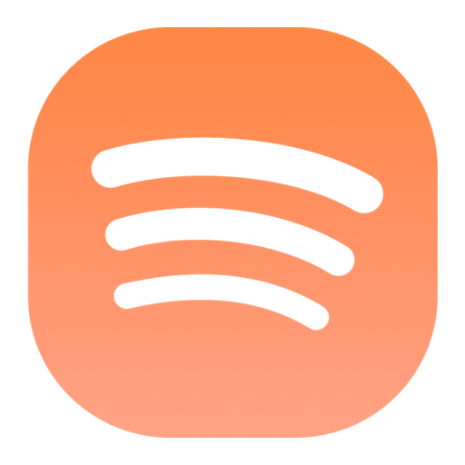
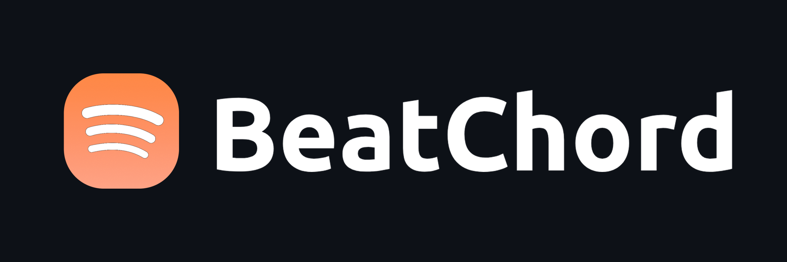

<div align="center">

<br/>



# BeatChord

### Your music. Your device. Nothing in between.

A local-first music player for Android and the desktop, built on the music files
you already own.

<br/>

[](https://github.com/ShortNaas/BeatChord/releases)
[](https://github.com/ShortNaas/BeatChord/blob/main/LICENSE)

<br/>

[**Features**](#features) · [**Download**](#download) · [**Build**](#build) · [**Contributing**](#contributing) · [**Privacy**](#privacy)

<br/>



</div>

> [!IMPORTANT]
> BeatChord plays files that are already on your device. It does not download,
> stream, host or recommend music, and it is not affiliated with, endorsed by or
> connected to YouTube, Google or any streaming service.

---

<h2><a id="features"></a>Features</h2>

**Playback**

- Local library scanned from the device (MediaStore) or a folder you pick — albums,
  artists and folders are derived from the files' own tags.
- Background playback through a proper media session, with the queue, shuffle,
  repeat, sleep timer and playback-speed controls you expect.
- Gapless playback with true crossfade (0–12 s) and **Automix** — beat-matched
  transitions analysed on-device.
- Per-device output control: system equalizer, spatial audio, USB DAC and hi-res
  output negotiation, DSD (DSF/DFF) decoding, and a loudness stage.
- Android Auto, a home-screen widget, and the system media notification.

**Library & discovery**

- Home shelves dealt from your own music and reshuffled each launch: recently
  added, artists, albums and quick picks.
- Library shelves for All Songs, Most Played, Recently Played, Recently Added and
  Never Played, with their own full-screen views and time-window filters.
- Local playlists, a persistent **Favorites** list, `.m3u/.m3u8` import and export.
- Search filters the local library as you type; recent searches are kept on device.

**Listening stats & Replay**

- Play counts, listening time and a wrapped-style **Replay** whose posters can be
  shared as images — computed entirely from local history.

**Files**

- Delete, move between folders, and edit the Title/Artist/Album tags *in the file
  itself* (FLAC `VORBIS_COMMENT`, M4A `ilst`), preserving artwork and any
  embedded lyrics.
- Offline lyrics: embedded lyrics first, then the local cache/`.lrc` sidecar,
  and only then a provider fetch — which is cached to both for next time.

**Looks**

- Material 3 UI with artwork-driven colour, frosted glass bars, a full-screen
  player with word-synced lyrics, and a landscape/tablet layout.

---

<h2><a id="download"></a>Download</h2>

Grab the latest APK or desktop package from the
[Releases](https://github.com/ShortNaas/BeatChord/releases) page. Sideloading the
APK requires enabling "Install unknown apps" for whichever app you download it
with.

For the desktop build, see [DESKTOP.md](DESKTOP.md).

---

<h2><a id="build"></a>Build</h2>

Requirements: JDK 17+, the Android SDK for the phone app (with `sdk.dir` in
`local.properties`), and a JDK for the desktop app.

```bash
./gradlew :app:assembleDevDebug   # Android APK
./gradlew :desktopApp:run         # Desktop app
./gradlew test                    # Tests
```

The native audio analysis and DSD decoders are built by CMake as part of the
Android build; see `native/` for their sources and the FFmpeg build script.

---

<h2><a id="contributing"></a>Contributing</h2>

Contributions are welcome. Please read the [Contributing Guide](CONTRIBUTING.md)
and [Code of Conduct](CODE_OF_CONDUCT.md) first.

[**Contributing Guide**](CONTRIBUTING.md) · [**Code of Conduct**](CODE_OF_CONDUCT.md) · [**Maintainers**](MAINTAINERS.md) · [**Additional Docs**](ADDITIONAL.md)

### Credits

- Lyrics providers: [LRCLIB](https://lrclib.net), [lrc.red](https://lrc.red),
  [BetterLyrics](https://github.com/better-lyrics/better-lyrics),
  [BiniLyrics](https://github.com/binimum),
  [PaxSenix](https://lyrics.paxsenix.org), [SimpMusic](https://github.com/maxrave-dev/SimpMusic),
  [Unison](https://unison.boidu.dev), [Megalobiz](https://www.megalobiz.com),
  [KuGou](https://www.kugou.com), [Musixmatch](https://www.musixmatch.com) and
  [Genius](https://genius.com).
- Lyrics animation inspired by [binimum/am-lyrics](https://github.com/binimum/am-lyrics).
- Beat tracking uses the MIT-licensed **Beat This!** model, run on-device with
  ONNX Runtime.

---

<h2><a id="privacy"></a>Privacy</h2>

BeatChord is local-first by design:

- **No account, no telemetry, no analytics, no crash reporting, no scrobbling.**
- **No remote library.** Nothing is uploaded or synced anywhere.
- **The only network traffic is:**
  1. lyrics, fetched on demand and cached locally (JSON + `.lrc` sidecar); and
  2. the **opt-in, default-off** artist genre lookup used by the Replay charts,
     which can look an artist's tags up once and caches the answer.

The app asks for `INTERNET` for those two things and nothing else.

---

<h2><a id="disclaimer"></a>Disclaimer</h2>

- **Local files only.** BeatChord does not host, upload, store or distribute music.
  It indexes and plays the audio files on the device it is installed on.
- **Copyleft.** BeatChord is free software under the GPLv3. The license does not
  let anyone forbid others from selling or redistributing copies, but any
  distribution must come with the Corresponding Source under the same license.
- BeatChord is not associated with Google LLC, YouTube, or any streaming service.

<div align="center">

<br/>

Made with care by [Naas](https://naas.work) · [@shortnaas](https://x.com/shortnaas)

</div>
